# WailsTools

> 当前版本：**v1.3.9**（每次发布构建补丁号 +1）

一套 Go + Wails v2 的桌面客户端，以及配套的 Go 同步服务端。覆盖：云同步笔记、文件管理、SSH（含跳板与服务器中转）、FTP/FTPS、HTTP 下载工具、网盘管理（夸克 / UC / 百度）、按连接类型独立配置的代理。

界面为深色优先的自绘 UI（非模板、非参考项目界面）。

## 界面预览

| 云同步笔记 | 下载工具 |
| --- | --- |
| 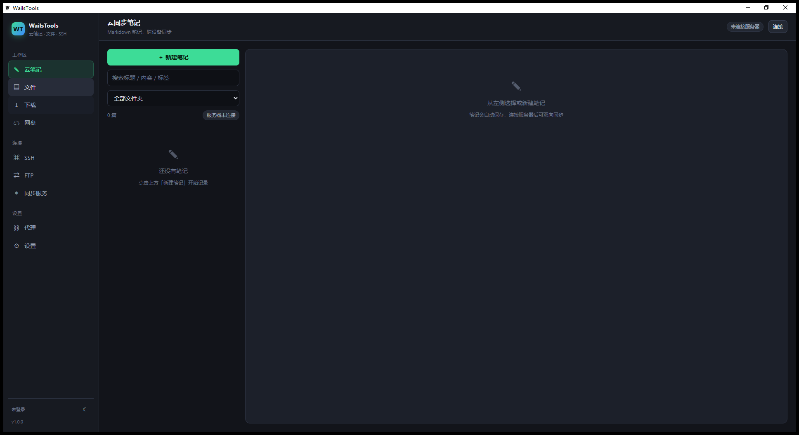 | 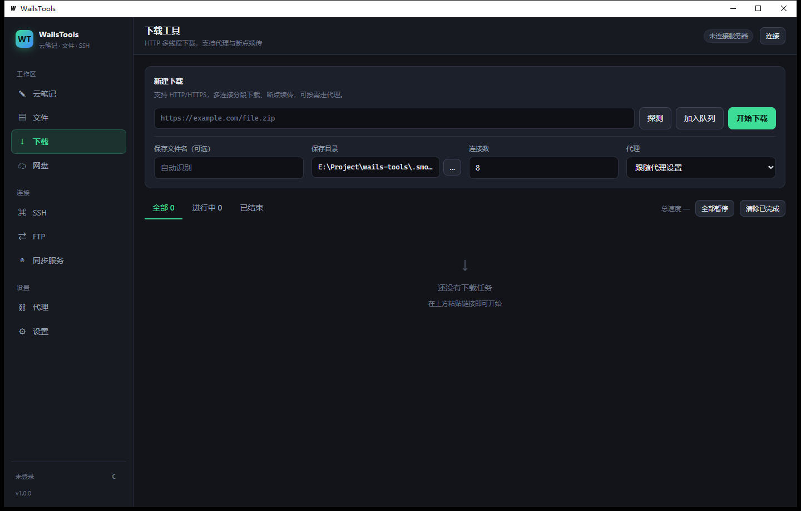 |

| 代理设置（按连接类型分别走或不走） | 同步服务器（UDP 优先 / TCP 回退） |
| --- | --- |
| 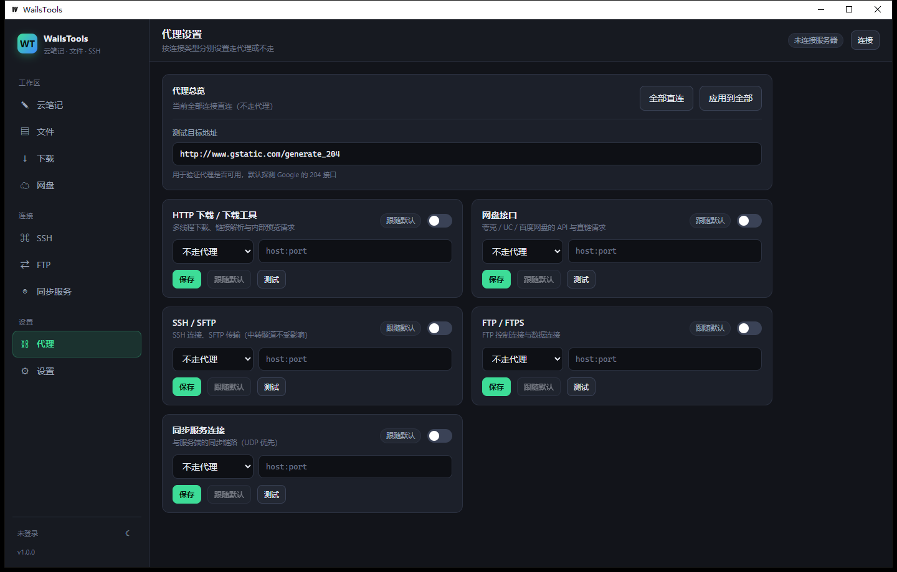 | 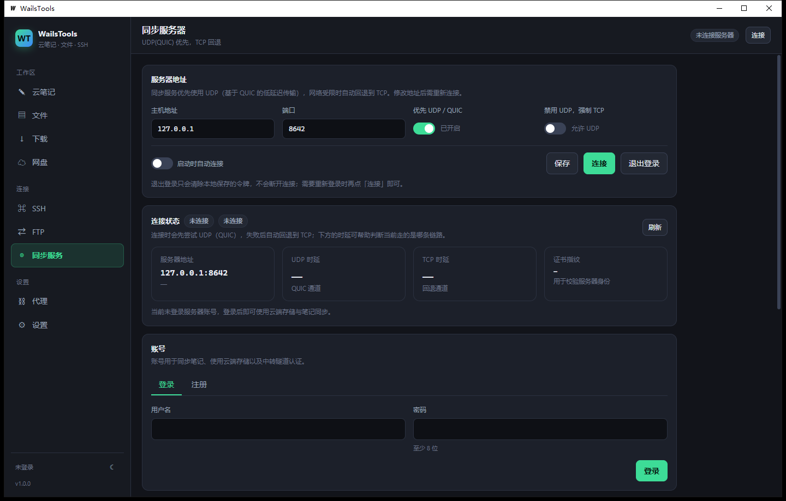 |

| SSH 管理 | FTP 管理 |
| --- | --- |
| 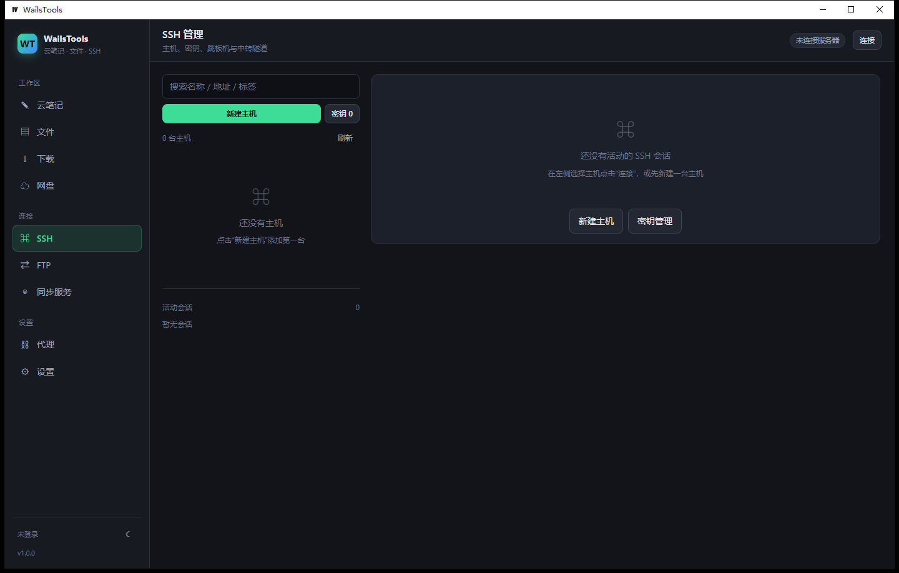 | 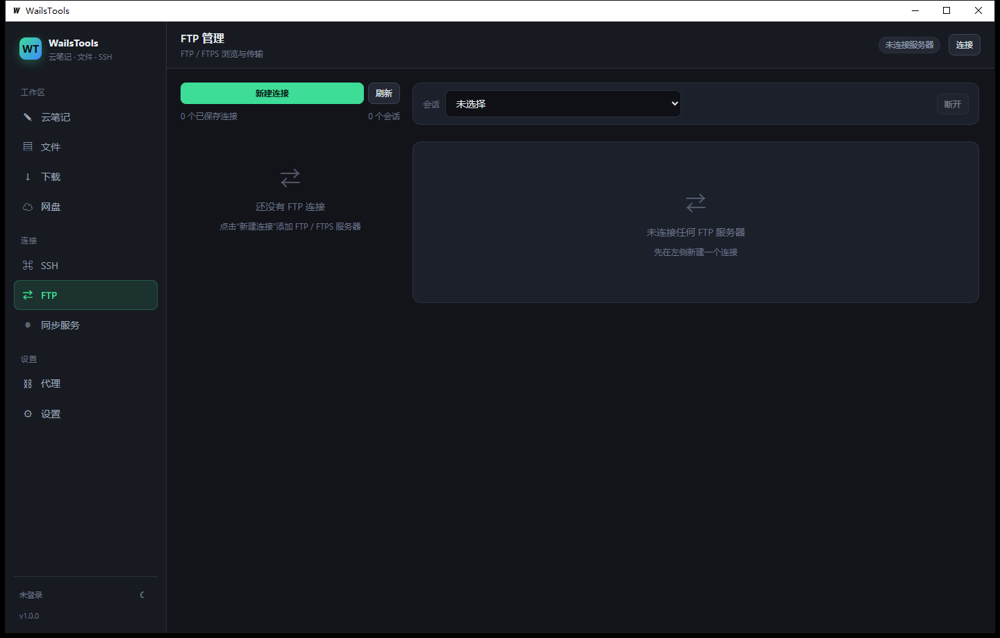 |

| 网盘管理 | 设置 |
| --- | --- |
| 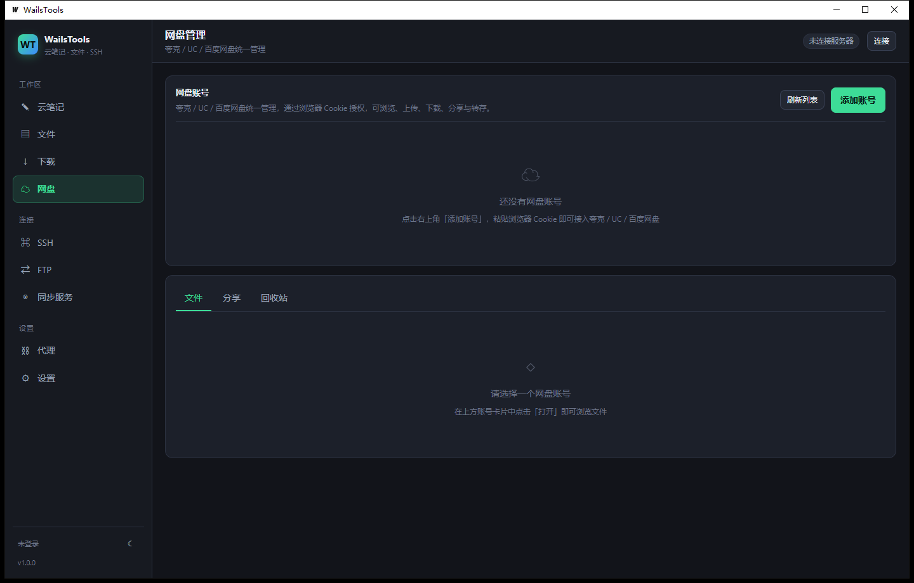 | 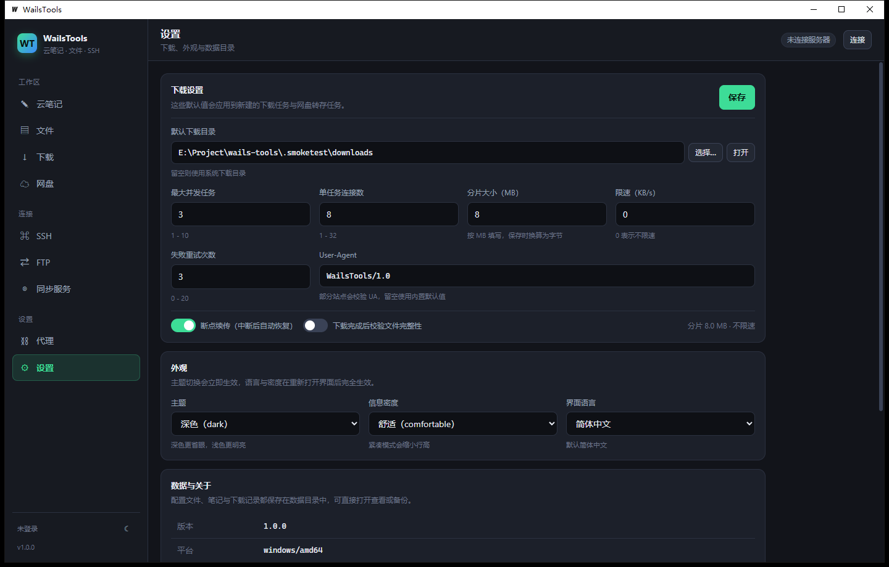 |

| 代理订阅 | 截图自动保存 |
| --- | --- |
| 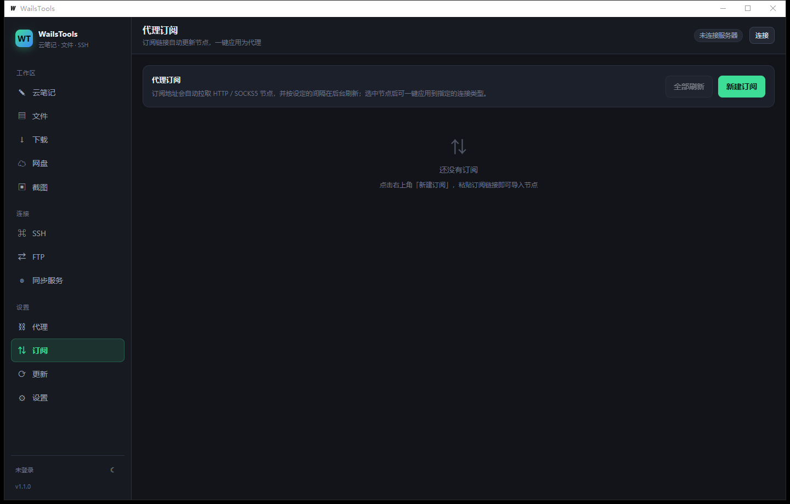 | 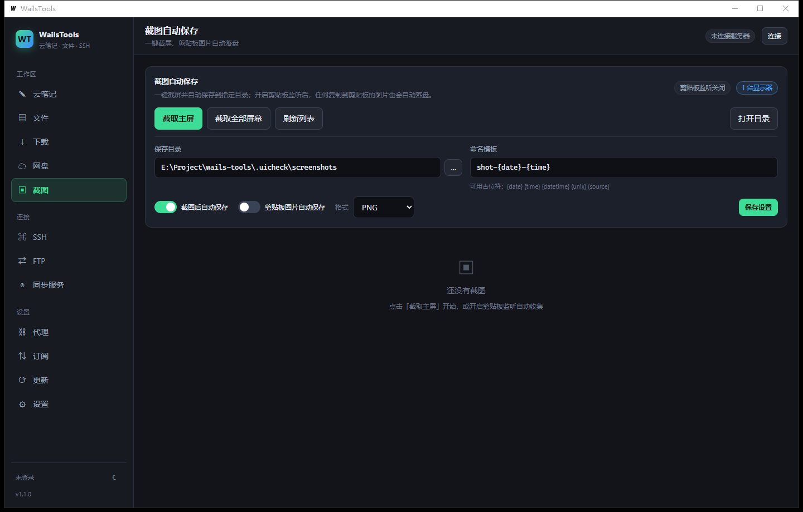 |

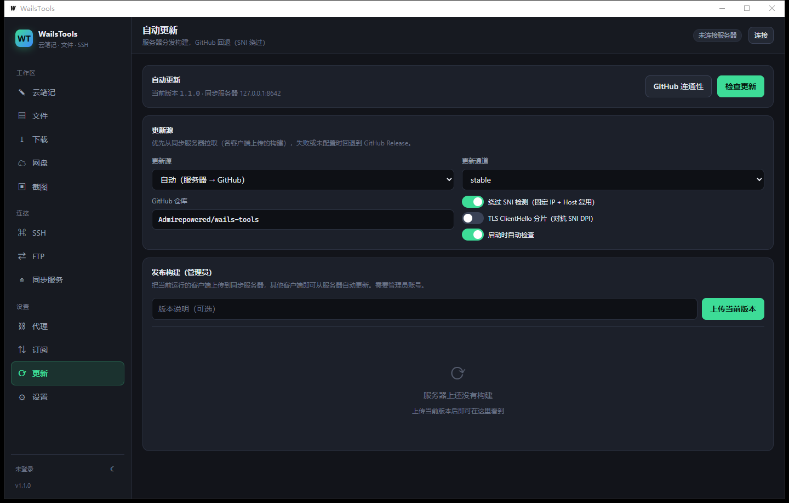

托盘图标与右键菜单（关闭窗口后仍驻留，双击恢复）：


连接成功后顶部会显示实际使用的传输方式（`UDP · QUIC` 或 `TCP 回退`）与地址：

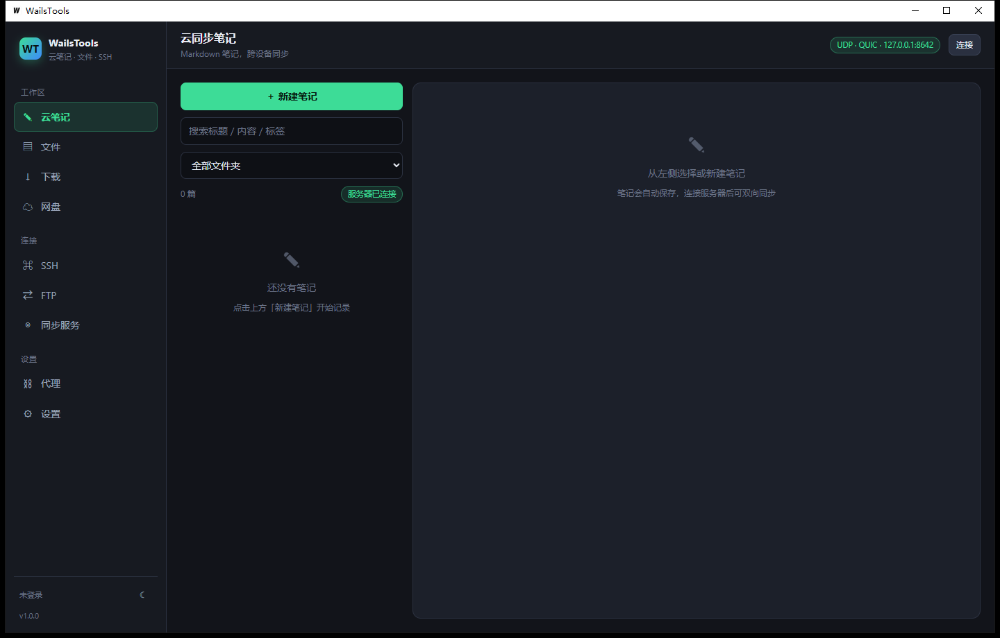

---

## 功能总览

| 模块 | 能力 |
| --- | --- |
| 云同步笔记 | Markdown 编辑/预览、文件夹与标签、置顶、自动保存、双向同步（最后写入优先 + 墓碑删除）、导出 `.md` |
| 文件管理 | 本地目录浏览、服务端云端存储浏览、双向上传/下载、新建目录、重命名、删除、配额展示、传输进度 |
| SSH 管理 | 主机/分组/搜索、密码 / 密钥 / keyboard-interactive / agent 认证、RSA·Ed25519·ECDSA 密钥生成与导入、公钥复制、私钥导出、主机指纹 TOFU 固定、直连 / 跳板机链 / 服务端中转三种路由、SFTP 浏览与传输、交互式终端（PTY）、单条命令执行 |
| FTP 管理 | FTP / 隐式 FTPS / 显式 FTPS（AUTH TLS）、被动模式、目录浏览、上传/下载、新建/重命名/删除、多会话 |
| 下载工具 | HTTP(S)、多连接分段下载、断点续传、自动重试、限速、进度/速度事件、任务队列与并发控制、按任务选择走代理或直连、文件名识别（Content-Disposition） |
| 网盘管理 | 夸克网盘、UC 网盘、百度网盘：Cookie 账号、文件列表/搜索、上传、**右键下载/删除**、**一键下载整个目录**、分享、回收站、视频预览；百度下载走本地「线路 3」解析（gettemplatevariable → RC4 sign → dlink） |
| 代理 | 每个工具独立选择 **不走代理 / HTTP 代理 / SOCKS5 代理 / 内部代理**、代理链路（服务器跳转 / 节点中转，最多 2 跳）、直连规则（域名/IP/CIDR + geoip 国家直连）、系统代理、**记住上次选择的节点并在启动时自动恢复** |
| 代理订阅 | 订阅链接自动拉取节点（明文/Base64/Clash YAML），定时后台刷新，流量与到期信息；支持 VMess / VLESS / Trojan / Shadowsocks / HTTP / SOCKS5，节点一键切换、整表批量测速（http://www.gstatic.com/generate_204）并显示延迟 |
| 代理引擎 | 由 C 版 miproxy/Pulse 内核重写为 Go：VMess（AEAD/legacy 头 + WS/TLS）、VLESS、Trojan、Shadowsocks(AEAD)、本地 SOCKS5+HTTP 混合入站（多线程并发）；支持外部共享（0.0.0.0 + 认证）与系统代理开关 |
| 代理链路 | 可选「从服务器跳转」或「用已有节点中转」，最多 2 跳；直连规则支持自定义域名/IP/CIDR 与 **geoip.metadb 按国家直连**（MetaCubeX 数据，内置下载） |
| 截图自动保存 | 一键截屏（主屏/全部屏幕）、**全局快捷键（默认 Ctrl+Alt+S）**、自动落盘、剪贴板图片自动保存、**截图自动同步到服务器**、命名模板与格式可选、缩略图画廊 |
| 媒体查看 | 内置图片 / 视频 / 音频 / 文本查看器，可直接预览本地、云端与 SFTP 上的文件（WebView 内流式播放）；**所有图片/视频都在应用内打开，不调用系统外部程序** |
| 自动更新 | **默认从同步服务器按哈希检查更新**（比较运行中可执行文件的 SHA-256 与服务器构建哈希，版本号仅作兜底）；服务端分发构建（管理员上传、按平台/通道查询、SHA-256 校验），失败回退 GitHub Release；**绕过 SNI 检测**（固定 IP + Host 复用 + TLS ClientHello 分片） |
| 系统托盘 | 原生 Win32 托盘图标（无第三方依赖）：双击显示窗口、右键菜单（截图/同步/连接服务器/剪贴板/自启动/退出）、悬停显示连接状态、关闭窗口最小化到托盘 |
| 开机自启动 | Windows 注册表 Run 项 / Linux autostart 桌面项，一键开关 |
| 同步服务端 | 用户注册/登录（Argon2id）、令牌会话、每用户独立笔记与文件空间、配额、TCP 中转隧道、客户端构建分发、审计记录 |

### 网盘解析完全在本地

网盘模块**不经过任何中转服务器**：Cookie 保存在本地（AES-256-GCM 加密），文件列表、直链解析、上传与分享都由客户端直接请求夸克 / UC / 百度的官方接口完成，同步服务端只负责笔记与文件同步、以及可选的 SSH TCP 中转，完全不参与网盘请求。网盘接口统一走「网盘接口」这一代理作用域，可单独设置为走代理或直连。

---

## 架构

```
┌─────────────────────────── WailsTools 客户端 (Wails v2 + React/TS) ───────────────────────────┐
│  internal/app          Wails 绑定层（页面调用入口）                                            │
│  internal/notes        本地笔记库（JSON + 脏标记）                                             │
│  internal/sshmgr       SSH 主机/密钥、跳板链、SFTP、PTY                                        │
│  internal/ftpx         FTP/FTPS 会话与配置文件                                                 │
│  internal/dlengine     多连接下载引擎（分片/续传/限速/重试）                                    │
│  internal/netdisk      网盘提供方（夸克/UC/百度）                                              │
│  internal/proxyx       代理解析（HTTP CONNECT / SOCKS5 / 绕过）                                 │
│  internal/serverlink   服务端客户端（RPC、笔记、文件流、中转、构建上传）                        │
│  internal/miproxy      代理内核（VMess/VLESS/Trojan/SS + SOCKS5/HTTP 入站，C 版重写）           │
│  internal/proxysvc     代理引擎生命周期、自定义节点存储                                        │
│  internal/subscription 代理订阅（抓取/解析/定时刷新）                                          │
│  internal/shot         截图与剪贴板自动保存（GDI / CF_DIB）                                    │
│  internal/updater      自动更新（服务端 / GitHub + SHA-256）                                   │
│  internal/githubx      GitHub SNI 绕过客户端（固定 IP、Host 复用、ClientHello 分片）            │
│  internal/autostart    开机自启动（注册表 / autostart）                                        │
│  internal/tray         系统托盘（Shell_NotifyIcon + 隐藏消息窗口，纯 Go 无 cgo）                 │
│  internal/netx         QUIC(UDP) 优先 + TLS/TCP 回退的多路复用传输                              │
│  internal/wire         长度前缀 JSON 帧 + 流式接管协议                                          │
└───────────────────────────────────────────────────────────────────────────────────────────────┘
                                        │  UDP/QUIC（优先）  →  TCP+TLS（回退）
┌───────────────────────────────────────▼───────────────────────────────────────────────────────┐
│  wt-server: netx.Listen → 每流 wire.Serve → api（auth / notes / files / relay）                 │
│  store（bbolt）: users / tokens / notes / filemeta / audit；文件落盘于 data/files/<userID>/     │
└───────────────────────────────────────────────────────────────────────────────────────────────┘
```

### 传输与连接策略

- 客户端**先尝试 QUIC over UDP**（自签名证书 + 首次使用指纹固定 TOFU），失败或超时后**自动回退 TLS over TCP**（yamux 多路复用）。连接报告包含 `udpMs` / `tcpMs` / 两侧错误，界面顶部与「同步服务」页会显示当前走的是 `UDP · QUIC` 还是 `TCP 回退`。
- 每条逻辑操作用**独立流**承载：普通 RPC 是 JSON 帧；文件上传/下载与中转是「先确认帧，再裸字节」，因此大文件不占内存、错误可回传。
- **通过一个服务器中转管理另一台服务器**有两种实现：
  1. SSH 主机路由设为「中转」：客户端请服务端 `relay.tcp` 打洞到目标 `host:port`，随后在该流上直接跑 SSH 握手。
  2. SSH 主机路由设为「跳板」：按顺序经一台或多台已保存 SSH 主机 `direct-tcpip` 转发。
- 服务端中转需要认证，可整体关闭（`-relay=false`）。
- 自动更新的 GitHub 回退使用 `internal/githubx`：TCP 连到内置的可达 IP，TLS 的 SNI 与 HTTP Host 保持真实域名（绕过 DNS 污染/IP 封锁），并可选把 TLS ClientHello 拆成多个小 TCP 段（对抗按 SNI 特征匹配的 DPI）。每个候选都会尝试并回报实际生效的策略。

---

## 构建与运行

依赖：Go 1.24+、Node.js 18+、Wails CLI v2（`go install github.com/wailsapp/wails/v2/cmd/wails@v2.12.0`）、Windows 需 WebView2 运行时。

```powershell
# 客户端（开发热重载）
wails dev

# 客户端（生产构建，输出 build/bin/WailsTools.exe）
wails build

# 服务端
go build -o build/bin/wt-server.exe ./server/cmd/wt-server
```

或使用脚本：

```powershell
./scripts/build-client.ps1
./scripts/build-server.ps1
./scripts/dev-client.ps1
./scripts/run-server.ps1 -Port 8642 -Data ./.wt-server-data
```

### 服务端

```powershell
./build/bin/wt-server.exe `
  -data ./.wt-server-data `
  -tcp 0.0.0.0:8642 `
  -udp 0.0.0.0:8642 `
  -allow-register=true `
  -relay=true `
  -quota-gb 10 `
  -token-ttl 720h
```

| 参数 | 说明 |
| --- | --- |
| `-data` | 数据目录（默认 `%USERPROFILE%\.wails-tools-server`） |
| `-tcp` | TCP 回退监听地址（空则关闭） |
| `-udp` | UDP/QUIC 监听地址（默认与 `-tcp` 相同） |
| `-no-udp` / `-no-tcp` | 关闭对应传输 |
| `-allow-register` | 是否允许注册（首个账号始终可注册，并成为 admin） |
| `-relay` | 是否允许客户端经服务端中转 TCP |
| `-quota-gb` | 默认每用户配额 |
| `-token-ttl` | 会话令牌有效期 |
| `-create-user name[:password]` | 创建用户后退出（未给密码则随机生成并打印） |
| `-list-users` | 列出用户后退出 |

服务端首次启动会生成自签名证书（`data/tls/`）并打印 SHA-256 指纹；客户端首次连接会记录该指纹，之后指纹变化会拒绝连接。

### 客户端数据目录

Windows 默认 `%LOCALAPPDATA%\WailsTools`（可用环境变量 `WAILSTOOLS_HOME` 覆盖）：

```
settings.json        配置（代理、下载、服务端、外观）
master.key           AES-256-GCM 本地密钥（加密 SSH 密码/私钥等）
notes/notes.json     本地笔记
ssh/                 主机、密钥、known_hosts
ftp/profiles.json    FTP 连接配置
netdisk/             网盘账号与 Cookie
subscriptions/       代理订阅（节点、流量、刷新时间）
screenshots/         截图自动保存目录
downloads/           默认下载目录（含 .wt-state 续传状态）
```

---

## 安全说明

- 本地敏感字段（SSH 密码、私钥口令、FTP 密码、服务端令牌）使用 `master.key` 以 AES-256-GCM 加密后落盘，接口返回一律脱敏；编辑主机时留空密码表示「保留原密码」。
- 服务端口令使用 **Argon2id**（m=64MiB, t=3, p=2）哈希；令牌为 32 字节随机值，仅存 SHA-256 摘要。
- 传输层使用 TLS 1.3（QUIC）/ TLS 1.2+（TCP），自签名证书 + TOFU 指纹固定。
- 云端文件路径做规范化校验，拒绝 `..` 越权访问；配额在写入前校验。
- SSH 主机密钥默认 TOFU 固定，指纹变化会拒绝连接（可在主机上显式覆盖）。

---

## 测试

```powershell
go test ./...                    # 单元 + 端到端集成测试
cd frontend; npx tsc --noEmit    # 前端类型检查
```

覆盖范围：

- `internal/wire`：帧编解码、RPC 往返、错误透传、流式管道、握手鉴权。
- `internal/netx`：UDP 优先、强制 TCP、UDP 不可达时回退、证书指纹不匹配拒绝。
- `server/integration`：真实服务端 + 客户端：注册、登录、UDP/TCP 传输选择、笔记双向同步、每用户文件隔离、上传下载字节一致、越权路径拒绝、经服务端中转的 TCP 隧道。
- `internal/dlengine`：分段下载校验和、瞬时失败重试、暂停后续传、文件名解析、探测元数据。
- `internal/sshmgr`：RSA/Ed25519/ECDSA 生成、带口令私钥导入、密码密封与重载、真实 SSH 服务器连接与命令执行、经中转路由连接、错误口令失败、跳板路由校验。
- `internal/proxyx`：代理 URL 解析、绕过匹配（后缀/CIDR）、CONNECT 代理下的 HTTP 与原始 TCP、直连不经代理。

---

## 构建与自动发布

```powershell
# 构建并自动上传到同步服务器（需要管理员账号）
$env:WT_USER = 'admin'
$env:WT_PASS = 'password'
./scripts/build-and-publish.ps1 -Channel stable -Notes "本次更新说明"
```

`cmd/wt-publish` 通过 wire 协议（UDP 优先）把 `build/bin/WailsTools.exe` 连同版本、平台、SHA-256 上传到服务器；脚本默认每次发布把次版本号 +0.1 并同步更新 README 的版本行。客户端默认从服务器按哈希检查更新，也可以在「更新」页从已发布构建列表中任选一个版本安装。

## 部署与发布

服务端默认开启 `-local-admin`：来自回环地址（127.0.0.1 / ::1）且未携带令牌的连接会被视为管理员，便于通过 SSH 在服务器本机做维护；远程连接仍然需要账号密码。


- 服务端已部署在 `s2.admirecn.de:8642`（systemd `wt-server.service`，UDP/QUIC 优先 + TCP 回退），详见 [docs/deploy.md](docs/deploy.md)。
- 管理员在客户端「更新」页上传当前构建后，其他客户端即可从服务器自动更新；服务器不可用时回退 GitHub Release。
- 源码仓库：<https://github.com/Admirepowered/wails-tools>

## 目录

```
main.go                  Wails 入口
wails.json               构建配置
internal/app             Wails 绑定（settings/ssh/ftp/downloads/notes/server/netdisk）
internal/{wire,netx}     协议与传输
internal/{sshmgr,ftpx}   SSH 与 FTP
internal/{dlengine,notes,netdisk,proxyx,serverlink,settings,secretstore,paths,localvault,applog}
server/cmd/wt-server     服务端可执行
server/internal/{api,store,auth,server}
frontend/                React + TypeScript 界面
```


